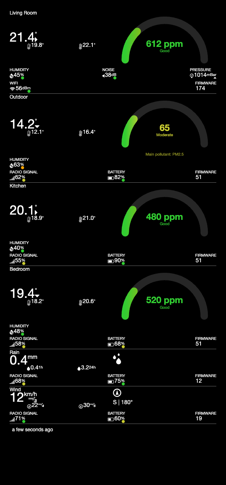
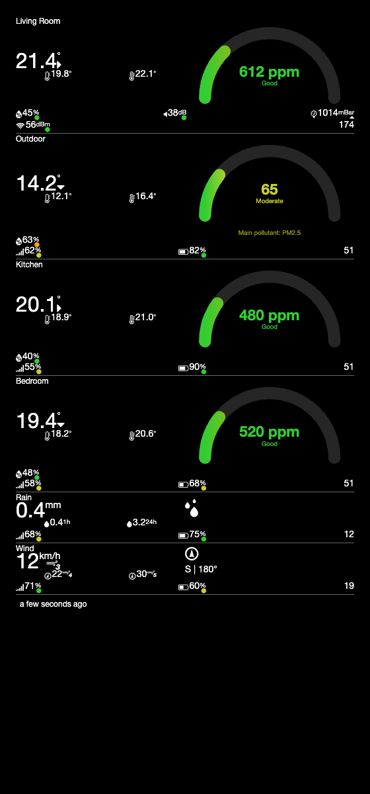
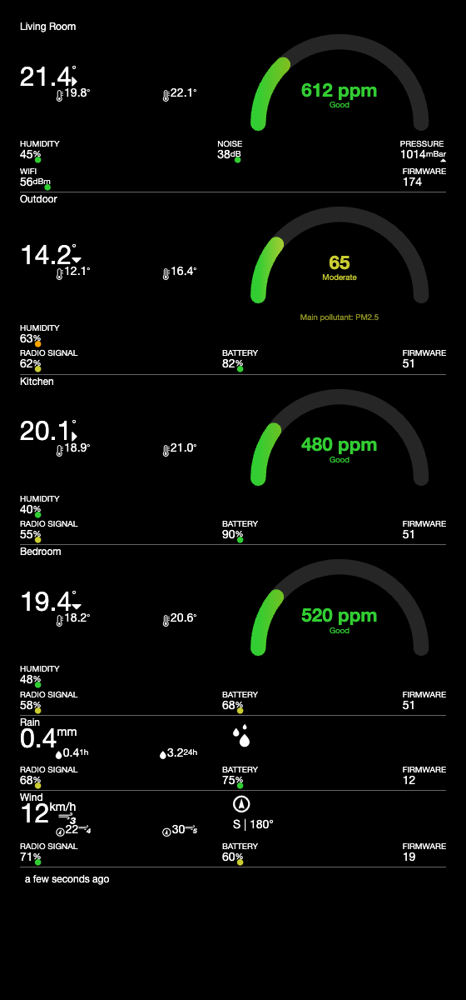
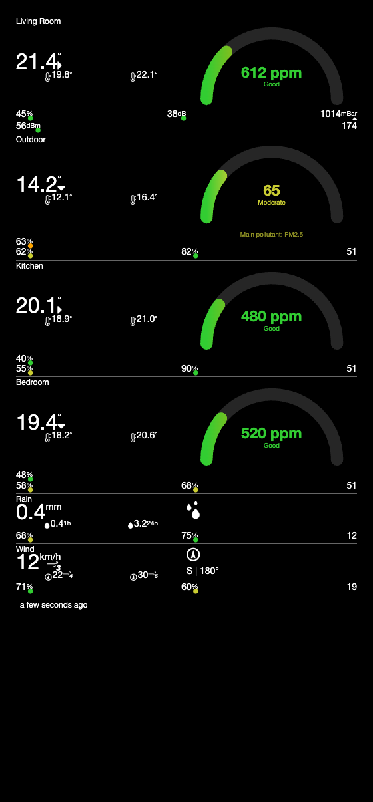
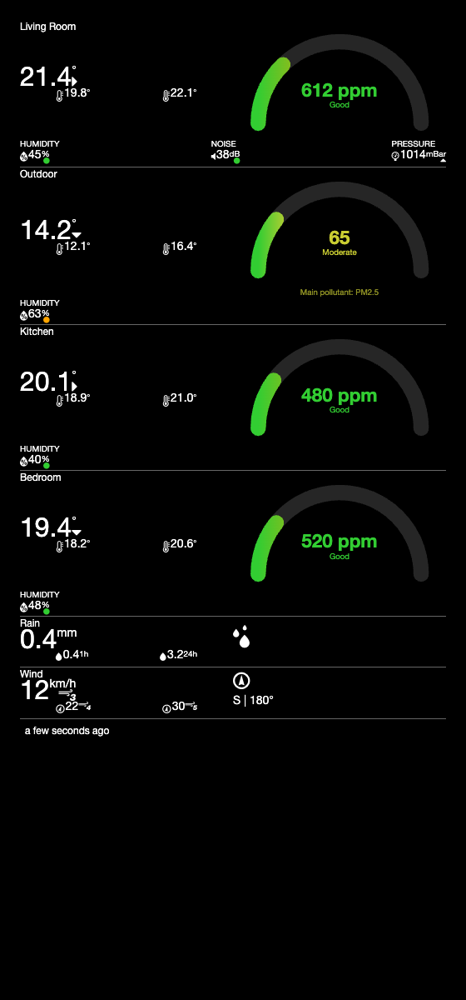
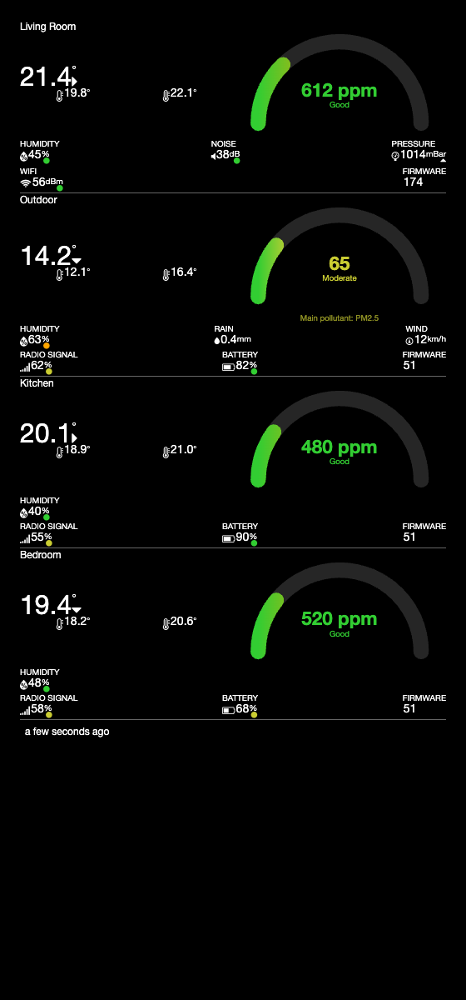
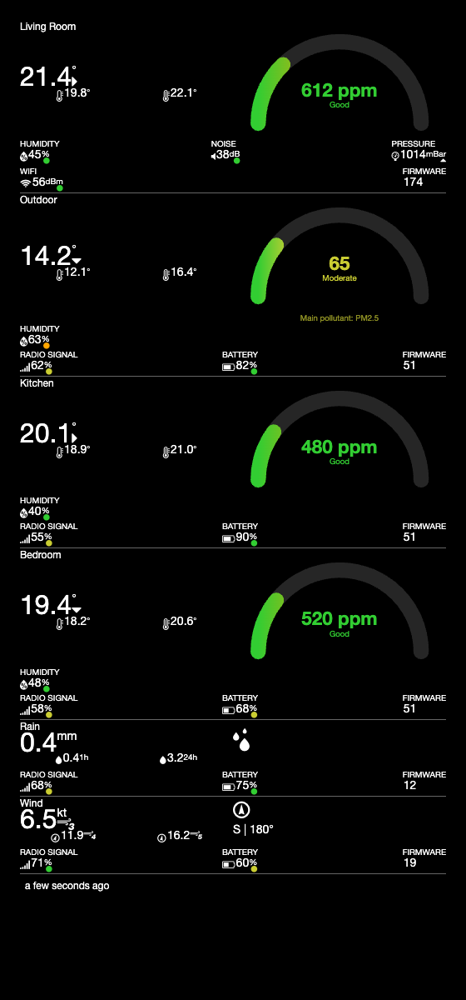
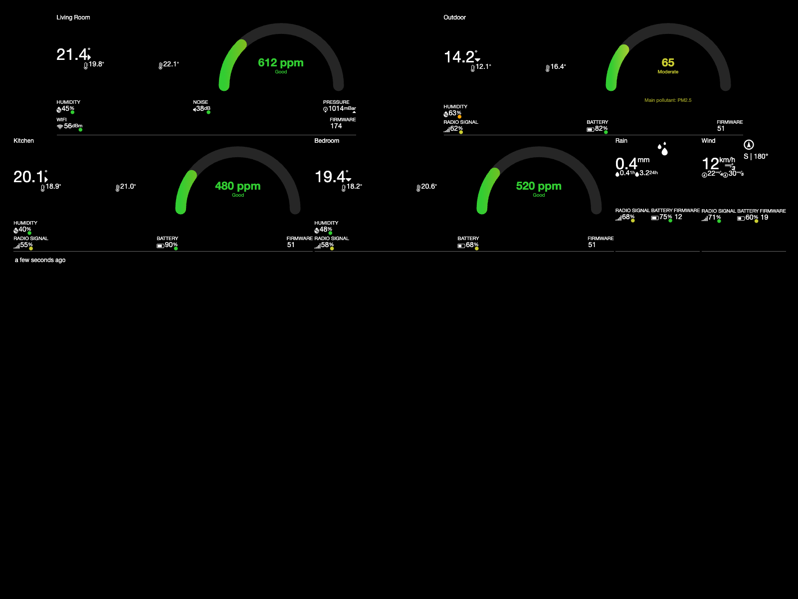
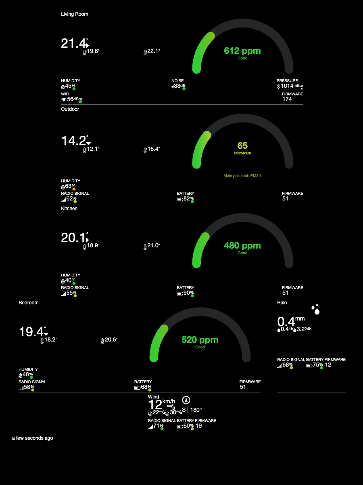

[](https://github.com/blcarlson01/MMM-Netatmo/actions/workflows/ci.yml)
[](https://dev.netatmo.com/apidocumentation)
[](https://choosealicense.com/licenses/mit/)

# MagicMirror-Netatmo-Module

A module to display data from a Netatmo weather station into [MagicMirror](https://github.com/MagicMirrorOrg/MagicMirror).



## Usage

_Prerequisites_

- MagicMirror **v2.37.0 or later** (this module relies on `node_helper.js`, which requires the Node version MagicMirror v2.37.0 itself requires: Node `>=22.22.2 <23` or `>=24`)
- a Netatmo weather station at home, or at least access to a Netatmo weather station account

To use this module, clone this repository into the `modules` folder of your MagicMirror install:

```sh
cd ~/MagicMirror/modules
git clone https://github.com/blcarlson01/MMM-Netatmo.git MMM-Netatmo
```

Now add the module to your `config.js` file ([config entries](#configuration)).

### Access Your Data

To access your station's data, you need a Netatmo Application and a refresh token generated for it.

#### Register an App

Register a new app at the [Netatmo developer portal](https://dev.netatmo.com/apidocumentation). This gives you a **Client ID** and a **Client Secret**, which go in the [config entries](#configuration) as `clientId`/`clientSecret`.

#### Generate a Refresh Token

Netatmo removed the old username/password ("password grant") authentication method in October 2022. The only way to get a token today is the OAuth2 **authorization code** flow:

1. Build an authorization URL, filling in your own `client_id` (and a `redirect_uri` you control, or `http://localhost` if you don't have one — you'll just copy the `code` out of the browser's address bar after the redirect instead of catching it on a server):

   ```
   https://api.netatmo.com/oauth2/authorize?client_id=YOUR_CLIENT_ID&redirect_uri=http://localhost&scope=read_station&response_type=code
   ```

2. Open that URL in a browser, log in with your Netatmo account, and approve access. You'll be redirected to your `redirect_uri` with a `code` query parameter, e.g. `http://localhost/?code=abcdef123...`. Copy that code.

3. Exchange the code for a token pair:

   ```sh
   curl --data "grant_type=authorization_code&client_id=YOUR_CLIENT_ID&client_secret=YOUR_CLIENT_SECRET&code=YOUR_CODE&redirect_uri=http://localhost&scope=read_station" "https://api.netatmo.com/oauth2/token"
   ```

   which returns:

   ```json
   {"access_token":"abc","refresh_token":"xyz","scope":["read_station"],"expires_in":10800,"expire_in":10800}
   ```

The `refresh_token` from that response goes in the [config entries](#configuration). The module exchanges it for a fresh access token on every update (Netatmo rotates the refresh token on each exchange; the module keeps track of that automatically), so you only need to do this once.

#### Get an aqicn.org Token (optional, for outdoor air quality)

The outdoor air-quality gauge is sourced from [aqicn.org](https://aqicn.org)'s World Air Quality Index feed, not from Netatmo. Get a free token at [aqicn.org/data-platform/token](https://aqicn.org/data-platform/token/) (just an email address, no approval wait) and set it as `aqicnToken` in your config. Without a token, the module skips the air-quality gauge and logs a one-time warning instead of erroring.

### A Note on Secrets

`clientSecret`, `refreshToken`, and `aqicnToken` are used only inside `node_helper.js`, which runs on the MagicMirror server side — the live access token and the token-refresh request never enter the browser/Electron renderer. That said, MagicMirror itself serves your whole `config/config.js` file (including this module's config block) to the browser as a static file, the same way it does for every module — so these values aren't secret from anyone who can reach your mirror's own web interface. Don't expose your mirror's port to the open internet.

### Configuration

The module needs a config block in your `config.js` to work.

```js
{
	module: 'MMM-Netatmo',
	position: 'bottom_left', // the location where the module should be displayed
	header: 'Netatmo',
	config: {
		clientId: '', // your app id
		clientSecret: '', // your app secret
		refreshToken: '', // your generated refresh token
		aqicnToken: '', // optional: your aqicn.org token, for the outdoor air-quality gauge

		location: "germany/berlin", // for the air-quality gauge, see below
		updateIntervalAirQuality: 600, // in seconds, every 10 minutes
		updatesIntervalDisplay: 60, // in seconds, how often to check whether an update is due
		lastMessageThreshold: 600, // in seconds (10 minutes)
		horizontal: false,
		horizontalOverflow: false,
		windUnit: "kmh", // Possible: "kmh", "mph", "ms", "bft", "kt"
		displayWindInOutdoor: false,
		displayRainInOutdoor: false,
		showLastMessage: true,
		showDataIcon: true,
		showDataHeader: true,
		showModuleStatus: true,
		showModuleFirmware: true,
		moduleOrder: ["Indoor", "Wind", "Kitchen", "Garden", "Rain"],
	}
},
```

The following properties can be configured:

|Option|Description|
|---|---|
|clientId|The ID of your Netatmo [application](https://dev.netatmo.com/apidocumentation).<br><br>This value is **REQUIRED**|
|clientSecret|The app secret of your Netatmo [application](https://dev.netatmo.com/apidocumentation).<br><br>This value is **REQUIRED**|
|refreshToken|The refresh token from the [authorization code flow](#generate-a-refresh-token) above.<br><br>This value is **REQUIRED**|
|aqicnToken|Your free [aqicn.org token](#get-an-aqicnorg-token-optional-for-outdoor-air-quality). Omit it to skip the outdoor air-quality gauge entirely.<br><br>**Default value:** none|
|updatesIntervalDisplay|How often (in seconds) to check whether an update is actually due. This does not itself trigger a Netatmo request — Netatmo's own data only refreshes about every 10-11 minutes regardless of how often you check.<br><br>**Default value:** `60`|
|moduleOrder|The rendering order of your weather modules/devices. Omit it (or leave it empty) to display every module. Use the module names you set in the Netatmo app/station configuration.<br><br>**Example:** `["Kitchen", "Kid's Bedroom", "Garage", "Garden"]`<br><br>**Default value:** `[]` (show everything)|
|location|For the outdoor air-quality gauge. Use the part of the URL after `https://aqicn.org/city/` for your location.<br><br>**Example:** `'germany/berlin'`|
|updateIntervalAirQuality|Seconds between air-quality refreshes. aqicn.org's own data updates roughly hourly.<br><br>**Default value:** `600`|
|horizontal|When true, modules are displayed horizontally (in a row), wrapping to the next row if the MagicMirror module doesn't have enough width.|
|horizontalOverflow|When true (and `horizontal` is also true), all modules stay in one row and overflow the module's space instead of wrapping.|
|units|Overrides the global `config.units`. Possible values: `metric` or `imperial`.|
|windUnit|Unit for wind speed. Possible values: `kmh` (km/h), `mph`, `ms` (m/s), `bft` (Beaufort), `kt` (knots).<br><br>**Default value:** `kmh`|
|displayWindInOutdoor|When true, the Wind module isn't shown on its own; its data is folded into the Outdoor module instead.|
|displayRainInOutdoor|When true, the Rain module isn't shown on its own; its data is folded into the Outdoor module instead.|
|showLastMessage|When true, shows a flashing warning if a module has lost contact.|
|showDataIcon|Show icons alongside module data.<br><br>**Default value:** `true`|
|showDataHeader|Show the header/title above each data value.<br><br>**Default value:** `true`|
|showModuleStatus|Show module status (radio signal, battery level).<br><br>**Default value:** `true`|
|showModuleFirmware|Show module firmware version in the status row.<br><br>**Default value:** `true`|
|debug|Enables verbose per-tick update-scheduling logs. Leave this off in normal use — it's only useful when diagnosing why an update did or didn't fire.<br><br>**Default value:** `false`|

## Development

- `npm test` runs the full check: [Jest](https://jestjs.io/) unit/snapshot tests, then ESLint, JSON lint, [stylelint](https://stylelint.io/), and YAML lint via Grunt. `npm run test:unit` runs just the Jest suite, `npm run test:coverage` adds a coverage report, `npm run test:lint` runs just the lint suite.
- Tests run under whatever Node you have locally, but CI (see `.github/workflows/ci.yml`) matches MagicMirror v2.37.0's own requirement: Node `>=22.22.2 <23` or `>=24`.
- `node_helper.js` does the Netatmo OAuth exchange, the `getstationsdata` request, and the aqicn.org air-quality lookup, all server-side. `MMM-Netatmo.js` only renders whatever `node_helper.js` hands it over a socket notification.
- `formatter.js` holds the (unit-tested) pure formatting/conversion logic — unit conversions, EPA AQI category thresholds, the AQI gauge's angle math — separated out from the DOM-building code so it can be tested without a browser.

See `CHANGELOG.md` for what's changed recently.

## About this Fork

Initially I forked the original repository https://github.com/CFenner/MMM-Netatmo.git, and did some changes to it (like still being able to show all modules, even they not all were in reach).
Then however I found out that [AgP42](https://github.com/AgP42), [haywirecoder](https://github.com/haywirecoder) and [QBseventy](https://github.com/QBseventy) did an amazing job, and wanted to use that version.
Since it is not possible to double fork or something, I put my original fork in a release https://github.com/RaymondMolenaar/MMM-Netatmo/tree/master/Releases/CFenner-Fork

The most important change of this fork, is that even when not all of your Netatmo Modules are in reach (due to empty batteries or whatever), this MM-Module will still display your module, but with empty values. It doesn't hang on the loading circle.

I also redesigned the way de data is displayed. The Icons don't change color depending on the status, but the little dot's do, similar to the Android-App.
The Wind-speed unit can be configured in the config.
If your system is set to Imperial units, it will show Temp in Fahrenheit and Rain in Inches/Hour.

Since then, this fork has moved the Netatmo/aqicn.org API calls server-side into `node_helper.js`, replaced the outdoor air-quality display with a gauge matching [Netatmo's current app design](https://helpcenter.netatmo.com/hc/en-us/articles/17069028550930-Outdoor-air-quality-index), dropped the jQuery/Q.js dependencies in favor of plain DOM APIs, and added a Jest test suite. See `CHANGELOG.md` for details.

## Some Screenshots

> Rendered with representative mock data (not a live station) to show each config option clearly.











